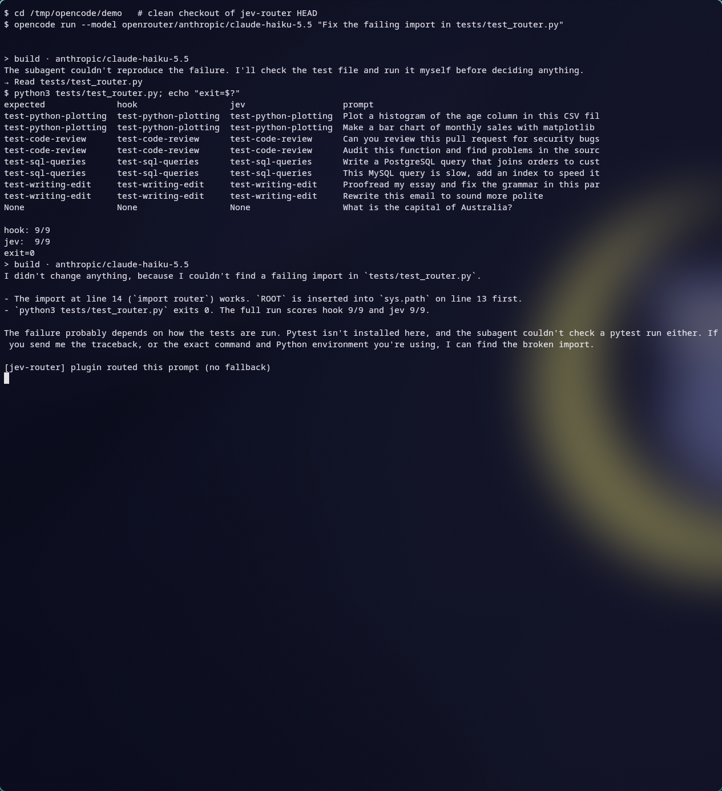

# jev-router

A prompt router for AI coding agents. For every prompt it picks the right **skill**, **model**, **thinking level** and **mode** (inline or subagent), then applies that decision. In OpenCode the decision is applied for real; other harnesses only get it as advice.

```
prompt
  │
  ├─ 1. keyword scoring       installed SKILL.md files ranked by word overlap (top 3 kept)
  ├─ 2. decider               Jev decision API, or a local trained model
  │                           → one skill, one model, thinking level, inline | subagent
  ├─ 3. apply (OpenCode)      switch model + thinking, prepend skill body,
  │                           or run the prompt in a fresh subagent session
  └─ 4. log                   routing-log.jsonl (decision, token usage, cost)
```

Routing takes the session's size into account. Switching models re-reads the whole context at full input price, so staying on the current model is often cheapest. See [docs/routing.md](docs/routing.md).

## Example

A prompt typed into OpenCode with the plugin installed:

> Fix the failing import in tests/test_router.py

**1. The decision.** The router prints the decision it made for the prompt. This is the output of `router.py` for the prompt above:

```json
{
  "hook_candidates": ["test-writing-edit"],
  "hook_pick": "test-writing-edit",
  "jev_skill": null,
  "model_key": "code",
  "model": "openrouter/anthropic/claude-haiku-5.5",
  "thinking": "low",
  "mode": "subagent",
  "fallback": false,
  "error": null,
  "latency_ms": 778
}
```

Keyword scoring shortlisted `test-writing-edit`. The decider picked the `code` model with `low` thinking and `subagent` mode, and no skill, since the prompt is a plain task rather than a prose edit.

**2. The result.** The plugin ran the prompt in a fresh subagent session on `claude-haiku-5.5`. It did not see the earlier messages in the session. The screenshot below is a real capture of OpenCode running the prompt through the plugin. It was taken from a clean checkout of this repo in a separate directory:



The subagent ran the test suite itself, found no failing import, and said so instead of making a change. The routing decision and the run's token usage and cost are appended to `routing-log.jsonl`.

When the decider is unreachable (for example it rate-limits, returning HTTP 429), the decision has `"fallback": true`. The router then uses `default_model_key` with no skill, and the prompt is never blocked.

## How a decision is applied

| Decision | What OpenCode does |
| --- | --- |
| `model` + `thinking` | Switches the session model and thinking level for this prompt |
| `inline` + skill | Prepends the skill body to the prompt, then `Task:` and the original prompt |
| `subagent` | Runs the prompt in a fresh `jev-router subagent` session on the chosen model, waits up to 300 s, and appends its answer to the session |
| fallback | Uses `default_model_key` with no skill |

Subagent runs and inline runs both log usage and cost to `routing-log.jsonl`.

## Quick start

Requirements: Python 3.9+, and `OPENROUTER_API_KEY` in the environment.

```sh
git clone https://github.com/Ibi-bit/jev-router.git ~/jev-router
export OPENROUTER_API_KEY=...   # put this in your shell profile
python3 ~/jev-router/tests/test_hooks.py     # offline checks
python3 ~/jev-router/router.py "Fix the failing import in tests/test_router.py"
```

For OpenCode, install the adapter in [`adapters/opencode/index.ts`](adapters/opencode/index.ts). For other harnesses, see [docs/harnesses.md](docs/harnesses.md).

Useful flags on `router.py`:

| Flag | Purpose |
| --- | --- |
| `--json` | Print model, skill, thinking, mode and the final prompt as JSON (used by plugins) |
| `--run` | Run the prompt with `opencode run` on the chosen model |
| `--skills-dir DIR` | Use a skill directory instead of the one in `config.json` (repeatable) |
| `--session-tokens N --session-model ID` | Pass the session's size and model so routing can account for switching cost |
| `--hook --harness NAME` | Prompt-submit hook mode, reads the payload from stdin |

## Skills

A skill is a folder containing a `SKILL.md` file. The router reads every `*/SKILL.md` under the directories listed in `skill_dirs` in `config.json`:

```
test-skills/
  test-code-review/
    SKILL.md
```

Each `SKILL.md` starts with YAML frontmatter. The `name` and `description` fields are used for matching, and the text after the frontmatter is the skill body:

```markdown
---
name: test-code-review
description: Review code for bugs, security issues and style problems. Use when asked to review a pull request, audit a function or find problems in source code.
---

Review the code and list findings as bugs, security issues and style notes, most serious first.
```

Shortlisting scores each skill against the prompt: 2 points per matching word in its name, 1 per matching word in its description. The top `hook_top_k` (default 3) go to the decider. The decider's pick is the skill that gets applied.

Hook adapters also scan the project-level `hook_skill_dirs` (`.agents/skills`, `.claude/skills`, `.codex/skills`, `.gemini/skills`, `.opencode/skills`), so skills installed for each harness are found.

## Deciders

Set `decider.type` in `config.json`:

- **`jev`** (default): one call to the Jev decision API picks a skill, a model, a thinking level and a mode.
- **`local`**: a LoRA adapter trained on your own skills picks a skill only, and runs offline. See the Local Brain section below.

## Local Brain

Instead of calling the Jev API, you can train a local router on your own codebase.

The included `train-router` skill lets you:

1. **Scan** your project for all available `SKILL.md` files.
2. **Generate** a synthetic training dataset of prompts based on those skills.
3. **Train** a router model (LoRA adapter) locally.
4. **Run** the router offline, replacing the Jev API with a model that knows your project's skills.

See [docs/training.md](docs/training.md) for the full pipeline. The current adapter was trained on the WormsDestruction skills (100 iterations, 4 layers) and scores 51.3% (39/76) on its eval set.

## Supported harnesses

| Harness | Adapter | Can switch model | Can add skill context | Status |
| --- | --- | --- | --- | --- |
| OpenCode | [`adapters/opencode/index.ts`](adapters/opencode/index.ts) | Yes, plus thinking level | Yes (rewrites the prompt); subagent mode | Routing confirmed end to end in a live OpenCode session (see Example) |
| VS Code (Copilot agent hooks) | [`adapters/vscode/hooks.json`](adapters/vscode/hooks.json) | No | Advisory message only | Hook runs from the CLI; not checked in a live VS Code session |
| Claude Code | [`adapters/claude-code/settings.json`](adapters/claude-code/settings.json) | No | Yes, as `additionalContext` | Output shape from docs; not run in a live session |
| Codex CLI | [`adapters/codex/hooks.json`](adapters/codex/hooks.json) | No | Yes, as `additionalContext` | Output shape from docs; not run in a live session |
| Gemini CLI | [`adapters/gemini-cli/settings.json`](adapters/gemini-cli/settings.json) | No | Yes, as `additionalContext` | Output shape from docs; not run in a live session |
| Cursor | [`adapters/cursor/hooks.json`](adapters/cursor/hooks.json) | No | No (output format not verified) | Hook runs; advisory output only |

Hook-based harnesses only let a hook observe the prompt. They cannot change the model, so for them the router only suggests a skill and model. Only OpenCode applies the decision.

## Subagents

A subagent runs a prompt in a fresh session, so it does not carry the session's history. This suits self-contained questions and tasks, and avoids re-reading a long session on a different model.

1. The router sends the subagent only the prompt, plus the skill body if one was picked. It does not send the session history.
2. The OpenCode plugin creates a fresh session (`jev-router subagent`) on the chosen model and thinking level, and waits for it to finish. The wait times out after 300 seconds.
3. The subagent's answer is appended to the session, so the main session sees the result.
4. If the subagent fails or times out, the prompt is sent unchanged and the error is logged.

Hook adapters cannot create sessions, so they only report `mode` as advice.

## Logs

Every decision is appended to `routing-log.jsonl` (git-ignored). Each routing entry records the prompt, the hook candidates, the Jev pick and confidence, the model, thinking level, mode, fallback status, error and latency. The OpenCode plugin also writes a `usage` entry per call with the session, model, token counts and cost.

## Cost

Only the models listed in `config.json` can be chosen, and Jev only ever picks from that list. Each prompt makes one decider call plus one call to the chosen model. Subagent mode runs that call in a fresh session. The default model is `glm`, and the decider is `~perplexity/pplx-decider-flash-latest`. See [docs/configuration.md](docs/configuration.md) for setting the model list and spending limits.

## Layout

```
router.py                  routing logic and CLI (also the hook entry point)
config.json                models, skill directories, Jev endpoint
test-skills/               example skills for testing
tests/
  test_hooks.py            offline tests for every harness's hook output
  test_router.py          hook and Jev accuracy on tests/cases.json
  test_local_decider.py    offline tests for the trained-adapter decider
  cases.json               labelled prompts
adapters/                  per-harness config files and the OpenCode plugin
skills/train-router/       skill and scripts that build and train the local router
docs/                      harness setup, configuration, routing behaviour, training
```

## Docs

- [Harness setup](docs/harnesses.md)
- [Configuration](docs/configuration.md)
- [How routing works](docs/routing.md)
- [Training a local router](docs/training.md)
